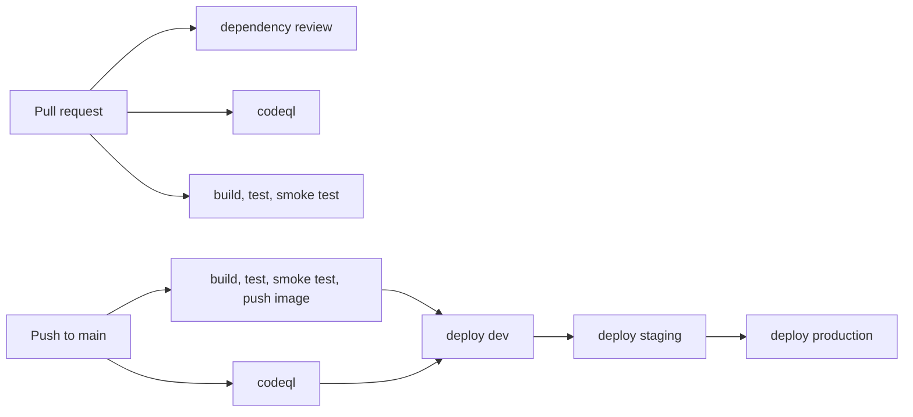

# hello-java-pipeline

Minimal Java service (Spring Boot 4, Java 21) that shows one pipeline file from pull
request to production, built on shared, versioned templates from
[pipeline-templates](https://github.com/christianlehnert/pipeline-templates).

The application itself is intentionally trivial. The point of this repository is the
pipeline: a single `.github/workflows/pipeline.yml` of about 80 lines that calls
reusable workflows by version.

## Endpoints

| Path | Response |
|---|---|
| `/` | `Hello from Java` |
| `/health` | `UP` (used by the smoke test) |

## Pipeline



| Job | Template | Runs on |
|---|---|---|
| `dependency-review` | `dependency-review.yml@v1` | pull requests |
| `codeql` | `codeql.yml@v1` | pull requests and main |
| `build` | `build-java.yml@v1` | pull requests (no push) and main (push to ghcr.io) |
| `deploy-dev`, `deploy-staging`, `deploy-production` | `deploy.yml@v1` | main, one after another |

What the pipeline guarantees:

- The image is built once and deployed by digest to every environment.
- Tests always run before an image is built.
- Every deployment first starts the image and checks `/health`.
- Third-party actions are pinned to commit SHAs inside the templates; Dependabot keeps
  Maven, Docker and GitHub Actions dependencies up to date.
- No stored secrets: the workflow token is read-only by default and each job requests
  only the permissions it needs.

The deploy step in the template is a placeholder that verifies and records the deployment.
On a real platform only the template changes, not this repository.

## Repository setup

The pipeline deploys to three GitHub environments. Create them before the first push to
`main`, either in the UI (Settings, Environments) or with the GitHub CLI:

```bash
REPO=OWNER/REPOSITORY                        # for example christianlehnert/hello-java-pipeline
USER_ID=$(gh api user --jq .id)              # the account that approves production

gh api --method PUT "repos/$REPO/environments/dev"
gh api --method PUT "repos/$REPO/environments/staging"

# production: one required reviewer, deployments only from main
gh api --method PUT "repos/$REPO/environments/production" --input - <<EOF
{
  "reviewers": [{ "type": "User", "id": $USER_ID }],
  "prevent_self_review": false,
  "deployment_branch_policy": { "protected_branches": false, "custom_branch_policies": true }
}
EOF
gh api --method POST "repos/$REPO/environments/production/deployment-branch-policies" \
  -f name=main -f type=branch
```

`prevent_self_review` is `false` here because a single maintainer would otherwise block
their own deployments. With a team, set it to `true` and add the team as reviewer
(`"type": "Team"` with the team id).

Further recommended settings:

1. Settings, Branches: protect `main` and require the checks of the `pipeline` workflow.
2. Settings, Code security: enable Dependabot alerts and security updates. CodeQL results
   appear under Security, Code scanning.
3. Required reviewers on environments are free for public repositories. Private
   repositories need GitHub Enterprise for this protection rule.

## Run locally

Requires Java 21 and Maven.

```bash
mvn verify                       # build and run the tests
java -jar target/hello-java.jar  # start on http://localhost:8080
curl http://localhost:8080/health
```

Build and run the container (after `mvn verify`):

```bash
docker build -t hello-java .
docker run --rm -p 8080:8080 hello-java
```

## Test the pipeline locally with act

[act](https://nektosact.com) runs GitHub Actions workflows locally in Docker. Running a job
before pushing avoids commits whose only purpose is to fix the pipeline.

```bash
act pull_request -l                                       # list jobs for pull requests
act pull_request -j build -s GITHUB_TOKEN="$(gh auth token)"
```

act does not reproduce everything. According to its documentation, environments and their
protection rules, `concurrency`, `permissions`, `timeout-minutes` and OpenID Connect are not
supported, and step summaries are discarded. Use act for fast feedback and GitHub for the
full run.

## Project layout

```
.github/
  workflows/pipeline.yml   the whole pipeline
  dependabot.yml           weekly updates for Maven, Docker, GitHub Actions
  CODEOWNERS
src/main/java/...          application
src/test/java/...          tests
Dockerfile                 copies target/hello-java.jar into a JRE image
pom.xml
```

## License

[MIT](LICENSE)
